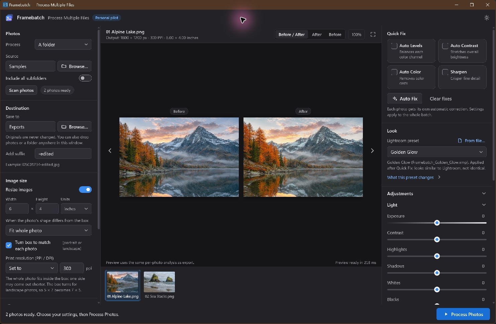
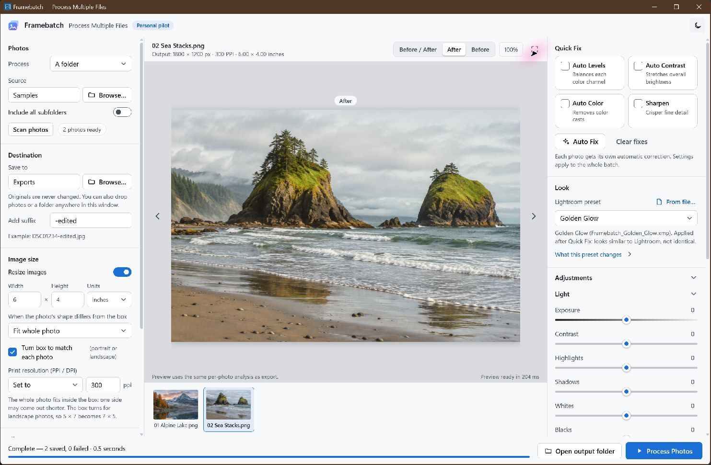

# Framebatch

Resize and export photos in batches on Windows. Apply your own Lightroom `.xmp` presets to the whole batch.

## Features

- Batch resize and export to JPEG, PNG, or WebP.
- Import Lightroom presets or choose **Dreamy Pastel** or **Golden Glow**.
- Compare before and after with Quick Fix and manual adjustments.
- Pause and resume batches. Framebatch preserves originals and existing exports.

## Screenshots

*Golden Glow before and after*



*Completed batch in light mode*



Screenshots use synthetic demo photos.

## Installation and build

Framebatch 0.9.0 targets **Windows 11 x64**. Build the installer from a checkout of this repository.

1. Install Node.js 22, Visual Studio 2022 C++ Build Tools, the Windows SDK, and the WebView2 Runtime.
2. Install the pinned Rust toolchain with the x64 MSVC target, Rustfmt, and Clippy.
3. Run the build script from the repository root in PowerShell.

```powershell
rustup toolchain install 1.99.1-x86_64-pc-windows-msvc --profile minimal --component rustfmt --component clippy
./scripts/build.ps1
```

The script installs the locked Node.js dependencies, runs the release tests, builds the desktop app and CLI, and packages an unsigned NSIS installer.

- **Installer:** run the generated setup executable under `src-tauri/target/release/bundle/nsis/` to install Framebatch for your Windows user.
- **CLI:** run `src-tauri/target/release/framebatch-cli.exe` from PowerShell.
- **GitHub Actions:** the Windows installer workflow runs when dispatched manually or when a tag matching `v*` is pushed.

Packaging downloads Microsoft's offline WebView2 installer. The dependency lockfiles pin the source dependencies, while the external WebView2 package can change.

## Usage

1. Choose a folder or select photos. You can also drop them into Framebatch.
2. Choose a separate output folder and set the size and file type.
3. To use a Lightroom preset, select **From file…** under **Lightroom preset** and open an `.xmp` file.
4. Select **Process Photos**. To continue an interrupted batch, reopen Framebatch and choose **Resume** when it appears.

### Command line

```powershell
./src-tauri/target/release/framebatch-cli.exe presets
./src-tauri/target/release/framebatch-cli.exe preset look.xmp
./src-tauri/target/release/framebatch-cli.exe run recipe.json journals-folder
./src-tauri/target/release/framebatch-cli.exe resume job.sqlite --retry
```

See [the recipe and job contracts](docs/CONTRACTS.md) for the data model.

<details>
<summary>Print sizing, Quick Fix, and preset compatibility</summary>

### Print sizing and export settings

- Original pixels: leave **Resize Images** unchecked. To change only print density, choose **Set to**, then enter **300**.
- 6 × 4 inch fit: check **Resize Images**, enter Width **6**, Height **4**, Units **inches**, keep **Fit whole photo**, then set **300 PPI**.
- A 3:2 landscape becomes **1800 × 1200 pixels**; a 4:3 landscape becomes **1600 × 1200 pixels**. Neither is cropped.
- **Turn box to match each photo** (on by default) swaps the box for photos of the other orientation, as Lightroom's and Capture One's "Dimensions" option does. At 5 × 7 inches and 300 PPI, a 3:2 portrait becomes 1400 × 2100 pixels (4.67 × 7 in) and a 3:2 landscape 2100 × 1400 (7 × 4.67 in). Turned off, the box stays 5 wide by 7 high, so the landscape comes out 1500 × 1000 (5 × 3.33 in). Percent sizes are never turned.
- When a photo's shape differs from the box (both dimensions entered):
  - **Fit whole photo:** nothing is cropped; one side comes out shorter.
  - **Fill and crop to exact size:** every photo is exactly the box size. The photo's center is kept and the ends of its longer side are cropped; a 3:2 photo at 5 × 7 loses about 7% of its long side. Check the preview for faces near the edges.
  - **Fit with white border to exact size:** every photo is exactly the box size, with the whole photo centered on white. Adjustments such as vignette apply to the photo, not the border.
  - **Stretch to exact size:** every photo is exactly the box size, distorting other shapes.
- Quick Fix analyzes each whole photo, so Fill and Border don't change a photo's auto correction. Recipes and unfinished jobs saved before these options existed keep their original behavior (fit, fixed box).
- Keep original preserves each source's density, including unspecified density. Physical sizing requires a density; missing values are reported before starting.

JPEG quality defaults to 92 and filenames gain `-edited`. Existing output files are never overwritten. JPEG uses a white matte for transparency. PNG and lossless WebP retain alpha. Outputs are tagged sRGB. Camera and GPS metadata are omitted by default. **Keep capture date, camera & exposure** retains a whitelist of valid photographic metadata and always excludes GPS. Damaged optional EXIF metadata is omitted so valid image pixels can still export. WebP print density may be ignored by Windows printing software; choose JPEG or PNG for printing until the intended print application is verified.

### Quick Fix behavior

Modeled on Adobe's documented Photoshop/Elements commands. Adobe's exact implementation is not public, so outputs will be similar to Elements, not identical. Analysis uses the same 960-pixel analysis image for preview and export. Checked fixes run in the dialog's order, each analyzing the previous fix's result.

- **Auto Levels** ("Enhance Per Channel Contrast"): each channel gets its own black and white point, ignoring the darkest/lightest 0.1% (Photoshop default). Can remove or introduce color casts, as in Elements.
- **Auto Contrast** ("Enhance Monochromatic Contrast"): one black/white point for all channels, ignoring 0.5% (Photoshop default), so colors are not shifted. Flat-color images are left unchanged.
- **Auto Color** ("Find Dark & Light Colors" + "Snap Neutral Midtones"): the average darkest and lightest 0.5% of pixels become neutral black and white, then a per-channel gamma makes near-neutral midtones gray at the same brightness. Framebatch safeguards: strongly colored extremes are neutralized only partially, gamma is limited to 0.75–1.33, and the midtone step is skipped when fewer than 0.5% of pixels are near-neutral. Warm scenes and saturated subjects are therefore not pulled toward gray, and strong tungsten casts are only partly removed. Use Warmth for the rest.
- **Sharpen** applies an unsharp mask with radius 1 and amount 0.35.

### Lightroom presets and manual looks

The **Lightroom preset** list in the Look section offers **Dreamy Pastel** and **Golden Glow** (Framebatch's own looks; see below). Use **From file…** to load any Lightroom/Camera Raw develop preset (`.xmp`, or the older `.lrtemplate`).

- **Stored with the job:** the preset's values go into the recipe and job journal, so resuming doesn't need the file.
- **Safety:** presets are parsed as data only, and nothing in them is executed. Lightroom profiles (`PresetType="Look"`) are refused.
- **CLI:** `framebatch-cli preset file.xmp` prints what was read; `framebatch-cli presets` lists the built-ins.

**Adjustments** has the same features as hand controls. Besides the basic sliders, there are:

- whites, blacks, vibrance and tint (in the Light and Color groups);
- Tone curve regions;
- Color mixer (choose a color band, then hue/saturation/luminance);
- Color grading (shadow/midtone/highlight/global wheels, balance, blending);
- Calibration;
- Effects (glow, vignette, grain);
- Black & white.

They run through the same engine as presets.

Order: Quick Fix, preset, manual looks, then the basic manual sliders. Adobe doesn't publish Camera Raw's processing, so results look similar to Lightroom, not identical.

- **From the preset's own data:** point tone curves (master, red, green, blue), using monotone cubic interpolation.
- **Approximated:**
  - tone: Exposure (with highlight roll-off), Contrast, Highlights, Shadows, Whites, Blacks, the parametric curve;
  - color: Temperature/Tint (the non-raw `Incremental` values), Vibrance, Saturation, color mixer (HSL, 8 bands), color grading/split toning, camera calibration, Black & White;
  - effects: Sharpening, vignette, grain, and negative Clarity (rendered as Glow: Clarity −50 is Glow 30).
- **How effects are placed:** vignette and grain use exported-pixel positions, so the preview and the 100% detail crop match the export. Grain uses a position-seeded pattern.
- **Reported as not applied:** positive Clarity, Texture, Dehaze, noise reduction, point color, black-and-white mix, profiles, masks/local adjustments, lens corrections, crop, raw (Kelvin) white balance and pre-2012 settings.

The window lists applied and not-applied settings for each preset.

### Glow, Dreamy Pastel and Golden Glow

**Glow** (Adjustments → Effects, 0–100) works like a mist or diffusion filter: each pixel is pulled toward a blurred copy of the photo (most in the midtones, as negative Clarity does), and the photo's bright areas are blurred twice as wide and screened back on, so light blooms softly into its surroundings without clipping. The blur radius is 1.2% of the exported photo's long edge, so the preview, the 100% detail view and every print size get the same look. The blurs run on a reduced copy, so glow adds little memory and time: on the test PC about 0.05 s per 5 × 7 in print and about 0.65 s per full-size 24 MP photo, with no measurable change in peak memory. Glow from a preset and from Adjustments adds up (to at most 100), and it is applied before sharpening.

**Dreamy Pastel** is an original look inspired by soft, airy community camera recipes; it doesn't reproduce any manufacturer's film simulation. It combines lifted blacks and rolled-off highlights, lower contrast, a slightly warm and pink white balance, pastel colors (softer greens and blues, lighter skin tones), teal shadows with peach highlights, Glow 30, fine grain and light sharpening. It is a normal Lightroom preset (`src-tauri/presets/Framebatch_Dreamy_Pastel.xmp`; in Lightroom its glow is plain Clarity −50).

**Golden Glow** is an original warm golden-hour look. It gives amber light with cream highlights, warm brown shadows, deep olive greens, rich but unclipped oranges and reds, light cyan-blue skies, moderately lifted blacks, soft highlights, Glow 12 with sharpening (bloom around light while leaves and textures stay crisp) and light grain. It's also a normal Lightroom preset (`src-tauri/presets/Framebatch_Golden_Glow.xmp`, Clarity −20 in Lightroom).

</details>

## Known limitations

- **Pilot reliability.** In a prior 10,000-photo GUI run, the app crashed after 6,929 exports. Recovery completed the job, but three repeated-input exports differed in their pixels. A separate 10,000-photo CLI run also produced three differing repeated-input exports. The cause remains unresolved.
- **Formats.** The pilot supports 8-bit still JPEG, PNG, and lossless WebP. Sony ARW and HEIC are unsupported. GPU acceleration and adjustable lossy WebP are outside this version.
- **Adobe compatibility.** Quick Fix and Lightroom preset rendering approximate Adobe's processing. The original Quick Fix prototype was unavailable for parity testing. The Look panel lists which preset settings were applied or skipped.
- **Recovery.** Jobs are stored under `%LOCALAPPDATA%/com.framebatch.desktop/jobs`. Journals accumulate until removed manually. Resume checks source and output hashes and recovers staged results without replacing existing files. This app uses correction engine `framebatch-0.7.0-provisional`. Jobs made with older correction engines are ineligible for resume.
- **Distribution.** Installer builds are unsigned. Windows printing software can ignore WebP density, so use JPEG or PNG for print workflows.

## Verification and benchmarks

Run the Rust checks from `src-tauri`:

```powershell
cargo +1.99.1 fmt --check
cargo +1.99.1 clippy --offline --locked --release --all-targets -- -D warnings
cargo +1.99.1 test --offline --locked --release
```

The offline checks require the locked dependencies to be available in the local Cargo cache. For independent file-level export verification, run these commands from the repository root:

```powershell
python -m pip install Pillow numpy psutil
cargo build --locked --release --features test-hooks --bin framebatch-cli --manifest-path src-tauri/Cargo.toml
python scripts/verify.py --exe src-tauri/target/release/framebatch-cli.exe --work ../framebatch-verify
cargo build --locked --release --bin framebatch-cli --manifest-path src-tauri/Cargo.toml
```

Use a new work directory for each run. The export checks reopen the outputs with Pillow and cover sizing, EXIF orientation, ICC conversion, metadata, collision protection, and recovery. The final command restores the production CLI without fault-injection hooks.

To benchmark a representative corpus with the production CLI:

```powershell
python scripts/benchmark.py --exe src-tauri/target/release/framebatch-cli.exe --corpus "C:/Photos/Representative" --work ../framebatch-benchmark --counts 1000 --workers 2 --memory 1024
```

Replace the example corpus path with a folder of representative photos. The benchmark stages copies and hardlinks in its own work directory, validates exports, and fails if repeated identical inputs produce different results. Use `--counts 10000` to exercise the larger batch. See [the implementation plan](docs/Framebatch_Windows_Implementation_Plan.md) for engineering context.
